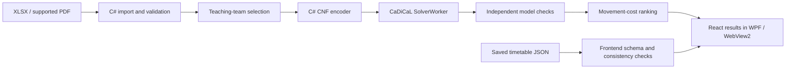

<div align="center">

# VNU-UET Custom Timetable Scheduler

**Build a personal timetable from existing VNU-UET course schedules, offline on Windows.**

[](https://github.com/PQMlmaoxd/VNU-UET-Custom-Timetable-Scheduler/actions/workflows/windows-desktop.yml)
[](https://github.com/PQMlmaoxd/VNU-UET-Custom-Timetable-Scheduler/releases/latest)
[](LICENSE)
[](docs/release/RELEASE.md)


[Download for Windows](https://github.com/PQMlmaoxd/VNU-UET-Custom-Timetable-Scheduler/releases/latest) · [Quick start](#quick-start) · [Architecture](#architecture) · [Documentation](docs/README.md)

</div>

The application selects existing teaching units for the courses and teaching teams you request. It rejects conflicting sessions and returns up to five distinct personal timetables. The institution's source timetable remains unchanged. This is a personal timetable selector, not a university-wide scheduling system.

## Quick start

1. Download the Windows x64 installer (`Setup.exe`) or portable ZIP from the [latest release](https://github.com/PQMlmaoxd/VNU-UET-Custom-Timetable-Scheduler/releases/latest).
2. Start the desktop app and load a supported XLSX timetable or signed, text-native UET PDF.
3. Select your course and teaching-team requests, then solve. Review the returned options in the results view.
4. Save a result as a versioned JSON timetable if you want to open it again later.

The app uses a local WPF/WebView2 interface and an isolated native SAT solver. Normal timetable processing does not require a server or an internet connection.

### Supported input

| Input | Handling |
| --- | --- |
| XLSX | Imports the supported fixed-timetable workbook schema and validates existing sessions. |
| PDF | Accepts the signed, text-native UET template implemented by the PDF importer. Scanned PDFs and unknown layouts are rejected. |
| Saved JSON | Opens a previously saved SAT result in the results view after frontend schema and consistency checks. |

A saved JSON file is an editable, non-authoritative snapshot. Opening it does not rerun the original workbook constraints or a formal proof because the source file and proof artifacts are not embedded. JSON loading also works in browser development mode; saving requires the Windows desktop bridge. The default saved filename is `TKB-<department>-<yyyyMMdd-HHmm>.json`.

## Architecture



| Component | Location | Responsibility |
| --- | --- | --- |
| Windows host | [`scheduler/desktop`](scheduler/desktop/README.md) | .NET 8, WPF/WebView2, local bridge, importers, validation, packaging |
| Native solver | [`native/SolverWorker`](scheduler/desktop/native/SolverWorker/README.md) | Isolated C++ process linked to pinned CaDiCaL 3.0.1 |
| User interface | [`scheduler/frontend`](scheduler/frontend/package.json) | React and TypeScript frontend bundled into the desktop app |
| Constraint specification | [`formal/spec`](formal/spec/hard_constraints.md) | Authoritative fixed-timetable and personal-selection constraints |
| Formal artifacts | [`scheduler/formal`](scheduler/formal/spec/clause_provenance_guide.md) | Proof-pipeline documentation and static formal test vectors |

Accepted solver models are independently checked before being shown in the UI. See the [architecture notes](docs/architecture/MIGRATION_CSHARP_CADICAL.md) and [native worker protocol](scheduler/desktop/native/SolverWorker/PROTOCOL.md) for implementation details.

## Movement cost

The SAT solver enumerates a bounded set of feasible timetables. The application then ranks those returned options by movement cost; movement cost is not part of the SAT objective.

For sessions on the same day, a transition contributes only when the next session begins at atomic period `p + 1` after the previous one ends at `p`. Other gaps contribute `0`.

| Cost | Transition |
| --- | --- |
| `0` | Same room |
| `1` | Different rooms in the same building |
| `2` | Different buildings in the same movement zone |
| `3` | Different movement zones |

Online sessions and sessions without a physical room contribute `0`. Zones come from [`RoomMovement.cs`](scheduler/desktop/src/Scheduler.Domain/RoomMovement.cs). Ranking is limited to the returned solutions and does not establish a globally movement-optimal timetable.

## Development and testing

The desktop projects target .NET 8 LTS. [`global.json`](scheduler/desktop/global.json) pins the SDK to `9.0.312`; the SDK version does not change the target framework.

From `scheduler/desktop` on Windows:

```powershell
dotnet restore Scheduler.sln
dotnet build Scheduler.sln --configuration Release --no-restore
dotnet test Scheduler.sln --configuration Release --no-restore
```

Build the native worker using its [Windows build guide](scheduler/desktop/native/SolverWorker/README.md) before running the complete release gate:

```powershell
.\scripts\verify-windows-release.ps1 `
  -SolverWorkerPath .\native\SolverWorker\out\windows-x64\SolverWorker.exe
```

Frontend scripts and requirements are in [`scheduler/frontend/package.json`](scheduler/frontend/package.json). The [contributor guide](CONTRIBUTING.md) lists the checks expected for changes. Public CI excludes external institutional fixtures; tests that require approved real timetable files must be run separately. A successful CI build alone is not evidence that those tests ran.

## UNSAT verification

When the solver reports UNSAT, the desktop app can export the canonical CNF, variable and clause metadata, hashes, and verification scripts. The export itself is not a proof.

For formal checking, `cake_lpr` verifies the matching LRAT proof against the exact hashed CNF. An accepted check requires a successful exit, the exact `s VERIFIED UNSAT` marker, matching externally recorded formula and proof hashes, and tool provenance. It establishes unsatisfiability of that CNF under the stated toolchain assumptions. It does not independently certify the timetable parser, the C# encoder, or their mapping to the intended scheduling constraints.

The optional checker source is under [`native/FormalVerification`](scheduler/desktop/native/FormalVerification/README.md). The pinned CakeML and HOL4 sources are Git submodules; clone with `--recurse-submodules` when you need the complete provenance tree. Formal packages can include course, lecturer, LHP, and session identifiers, so read the [data-handling policy](docs/policies/DATA_HANDLING.md) before sharing them.

## Releases

Tagged Windows releases publish an installer, a portable ZIP, a standalone diagnostics CLI, and a recursive CakeML/HOL4 source bundle. The installer and portable ZIP also contain `Scheduler.Diagnostics.exe`, which can check packaged files without starting the UI.

See the [release guide](docs/release/RELEASE.md) for CI and packaging steps. The [release acceptance checklist](scheduler/desktop/RELEASE_ACCEPTANCE_CHECKLIST.md) tracks manual Windows checks and additional evidence for production-labelled builds or formal-verification claims. A published release is not, by itself, proof that those approvals or optional signing checks have been completed.

## Documentation

- [Documentation index](docs/README.md)
- [Desktop development guide](scheduler/desktop/README.md)
- [Hard constraint specification](formal/spec/hard_constraints.md)
- [Release and deployment procedure](docs/release/RELEASE.md)
- [Contributing](CONTRIBUTING.md) and [security policy](SECURITY.md)

## License

Project source is available under the [MIT License](LICENSE). Bundled and vendored third-party dependencies retain their own licenses and notices.
